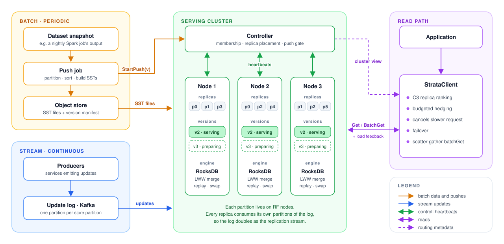
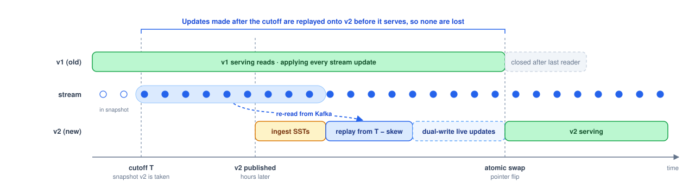

# Strata

**A low-latency serving store for derived data that merges batch snapshots with real-time updates correctly.**

[](https://github.com/sjwl07/Strata/actions/workflows/ci.yml)


ML features, recommendations and precomputed aggregates are usually produced twice: by a large batch job that periodically recomputes everything, and by a stream of real-time updates in between. Serving them means combining the two, and the obvious way to do it is wrong. A snapshot captures the world *as of a cutoff* but arrives hours later, so swapping it in silently discards every update made in the meantime.

Strata serves each key from versioned batch snapshots overlaid with a stream of updates. It merges them so that **a read never returns an older value than the system already knows about**, and its client keeps tail latency low when individual replicas slow down.

## Highlights

- **Correct batch + stream merge.** Last-writer-wins on event time with a deterministic total order, a snapshot-watermark filter, and log replay before every version swap. Verified by a randomized checker against an oracle: **0 wrong reads out of 501,456**, compared with 19% for a naive merge.
- **Instant, lock-free version swaps.** Snapshots are built offline as RocksDB SST files and hard-linked into place. Readers follow an atomic, reference-counted pointer, so swapping under load costs no errors and a one-second p99 blip of 0.38 → 0.76 ms.
- **Full and delta pushes.** Deltas layer only the changed keys on top of cached base files. The trade-off against full pushes is [measured](docs/experiments/q1-delta-push.md), not assumed.
- **Replication without a replication protocol.** Every replica consumes the same partition of the update log. Nodes that crash and lose their disk rebuild from the snapshot plus a replay and converge exactly.
- **Self-healing cluster management.** A controller with heartbeat-based membership, rendezvous-hash placement and a push gate. Nodes reconcile against the desired state on every heartbeat, so lost messages repair themselves.
- **Tail-latency-aware client.** C3 adaptive replica selection driven by load feedback that servers piggyback on every response, hedged requests under a token-bucket budget, cancellation of the losing request, failover, and scatter-gather batch reads. Under injected faults, **p99 is 17–63× lower than round-robin**.

## Results

Three questions, each answered with a reproducible experiment. All numbers come from a single laptop (Intel i3-1215U, 8 threads, 7 GB RAM); the write-ups give the method, raw data and limitations.

| Question | Finding |
|---|---|
| [**Does a naive batch/stream merge serve wrong data?**](docs/experiments/q2-merge-correctness.md) | Yes: **19%** of reads were wrong with arrival-order merging and **8.5%** with last-writer-wins alone, against **0%** with Strata's watermark + replay. A misconfigured clock-skew bound reintroduces 0.05% stale reads. Correctness costs about 4× in stream-apply throughput (still about 430k updates/s per node). |
| [**How much does replica selection reduce tail latency?**](docs/experiments/q3-tail-latency.md) | With a slow disk, GC-like pauses or noisy neighbours, C3 kept p99 near **0.6 ms**, versus 10–36 ms for round-robin, at zero extra load. Hedging rescues load-blind routing for about 3% extra requests, but small budgets drain under bursty faults. |
| [**When is a delta push better than a full push?**](docs/experiments/q1-delta-push.md) | A 1% delta ships **100× fewer bytes**, but computing it costs more than transferring a full snapshot over a fast local network. Deltas win when bandwidth per copy is scarce: below about (1 − f) × 57 MB/s on this hardware. |

## Architecture

<p align="center">
  
</p>

Data enters through two paths. The **batch path** periodically publishes a complete new version as SST files. The **stream path** delivers individual updates through Kafka. Every storage node hosts replicas of some partitions and combines both sources. The **controller** decides placement and when a new version goes live. Applications read through **StrataClient**, which picks the fastest replica using load feedback from the nodes.

### How a new version goes live

<p align="center">
  
</p>

Two rules make the merge correct:

1. **Merge:** each value carries `(event time, source)`, and the larger one wins under a total order, so replicas converge regardless of delivery order. Updates at or below a snapshot's cutoff are discarded, because the snapshot already reflects them, deletes included.
2. **Swap:** before a new version serves, it replays the log from `cutoff − max clock skew` and then receives every live update until the pointer flips. No update is lost in between.

[`docs/design.md`](docs/design.md) covers the read path, the version lifecycle, failure handling and a code map. [`docs/CONCEPTS.md`](docs/CONCEPTS.md) explains the same ideas with an analogy.

## Quickstart

Requires JDK 21; no Docker needed. The demo starts a controller and three storage nodes, each with its own gRPC server, and walks through the core scenario:

```sh
./gradlew :bench:installDist
bench/build/install/bench/bin/bench demo
```

```
1. Nightly batch job publishes edition v1: ravi=111, asha=555
   get(ravi) = 111
2. At 03:00 a sticky note arrives on the stream: ravi -> 222
   get(ravi) = 222
3. Edition v2 arrives. It was photographed at the cutoff, BEFORE the note: ravi=111
   get(ravi) = 222
   -> the note survived the swap (replayed onto v2 before it went live)
4. kill -9 n1 (its disk is gone too). Reads keep working:
   get(ravi) = 222
5. Bring n1 back empty. It bootstraps from the SSTs plus a log replay.
   n1 is serving again after 340 ms
```

Run it with `--mode=NAIVE` to see step 3 lose the update.

<details>
<summary><b>Running as separate processes</b></summary>

```sh
./gradlew :controller:installDist :storage-node:installDist :push-job:installDist :bench:installDist

# Controller and three storage nodes
controller/build/install/controller/bin/controller --port=7000 &
for i in 1 2 3; do
  storage-node/build/install/storage-node/bin/storage-node --node-id=n$i --port=710$i \
    --data-dir=/tmp/strata/n$i --objects=/tmp/strata/objects --controller=localhost:7000 &
done

# Create a store, build version 1 from a TSV file, and publish it
controller/build/install/controller/bin/strata-admin create-store --name=demo --partitions=4 --rf=2
printf 'ravi\t111\nasha\t555\n' > /tmp/v1.tsv
push-job/build/install/push-job/bin/push-job --objects=/tmp/strata/objects --store=demo \
  --partitions=4 --version=1 --input=/tmp/v1.tsv
controller/build/install/controller/bin/strata-admin start-push --store=demo --version=1

# Read through the smart client
bench/build/install/bench/bin/bench get --controller=localhost:7000 --store=demo --key=ravi
```

Pass `--kafka=host:9092` to the storage nodes to enable streaming updates, and `--delta-from=old.tsv` to the push job to publish a delta.

</details>

<details>
<summary><b>Running with Docker Compose and Kafka</b></summary>

[`deploy/`](deploy/README.md) runs Kafka, a controller and three storage nodes in separate containers, with a walkthrough of the stream-update-survives-swap scenario and a node being killed and recovering.

</details>

## Using the client

```java
var options = StrataClient.Options.defaults("localhost:7000")
    .withStrategy(ReplicaSelector.Strategy.C3)
    .withHedgeBudget(0.05);                       // at most 5% extra requests

try (var client = new StrataClient(options)) {
  Optional<byte[]> value = client.get("demo", key).join();
  Map<ByteString, byte[]> values = client.batchGet("demo", keys).join();
}
```

The client depends only on the API definitions, gRPC and HdrHistogram, and can be used on its own: `./gradlew :client:publishToMavenLocal` publishes `io.strata:strata-client:0.1.0`.

## Project layout

| Module | Responsibility |
|---|---|
| [`storage-node`](storage-node) | Versioned RocksDB engine, stream apply, replay and swap, gRPC service, cluster agent |
| [`client`](client) | Smart client: C3 selection, hedging, cancellation, failover |
| [`controller`](controller) | Membership, placement, push lifecycle, cluster view, `strata-admin` CLI |
| [`push-job`](push-job) | Builds full and delta versions: partition, sort, write SSTs, publish manifest |
| [`common`](common) | gRPC/Protobuf APIs, partitioner, value format and merge order, log and object-store interfaces |
| [`sst`](sst) | SST file format shared by the push job and the nodes |
| [`kafka-log`](kafka-log) | Kafka implementation of the update log |
| [`checker`](checker) | Randomized correctness checker with an oracle |
| [`fault`](fault) | Fault injection: slow disk, stop-the-world pauses, noisy neighbours |
| [`local-cluster`](local-cluster) | Controller and N nodes in one JVM, with kill and restart |
| [`bench`](bench) | Demo, experiments, open-loop load generator, JMH benchmarks |

## Development

```sh
./gradlew build                                          # compile, format check, all tests
./gradlew spotlessApply                                  # format code
./gradlew :checker:test -Pchecker.histories=40 --rerun   # longer randomized correctness run
./gradlew :bench:installDist                             # then: bench/build/install/bench/bin/bench q1|q2|q3
./gradlew :bench:jmh -Pjmh.includes=ReadPathBenchmark -Pjmh.prof=gc
```

Kafka integration tests use Testcontainers. They run wherever Docker is available, including CI, and are skipped elsewhere.

## Scope and limitations

- **Single-machine experiments.** The multi-node cluster runs in one JVM over loopback gRPC with datasets of 0.1–1M keys. The relative results and the mechanisms are what carry over; absolute numbers will differ in production.
- **Local stand-ins for some external systems.** S3 and Spark sit behind interfaces ([ADR 0001](docs/adr/0001-local-substitutes-for-kafka-minio-spark.md)): the object store is a shared directory, and the push job is plain Java performing the steps a Spark job would. Kafka is real in the Docker setup and the integration tests; the experiments use an in-memory log with the same semantics.
- **Not yet implemented:** controller high availability, C3's rate control, per-field merges and Iceberg input. See the roadmap in [`docs/PROGRESS.md`](docs/PROGRESS.md).

## Documentation

| Document | Contents |
|---|---|
| [Design](docs/design.md) | How the system works end to end, failure handling, invariants, code map |
| [Concepts](docs/CONCEPTS.md) | The problem and the solution in plain language |
| [Decision records](docs/adr/) | Six ADRs, each with the alternatives considered |
| [Experiments](docs/experiments/) | Phase 1 baseline and Q1–Q3, with raw data |
| [Build journal](docs/JOURNAL.md) | Step-by-step development history, including bugs found along the way |
